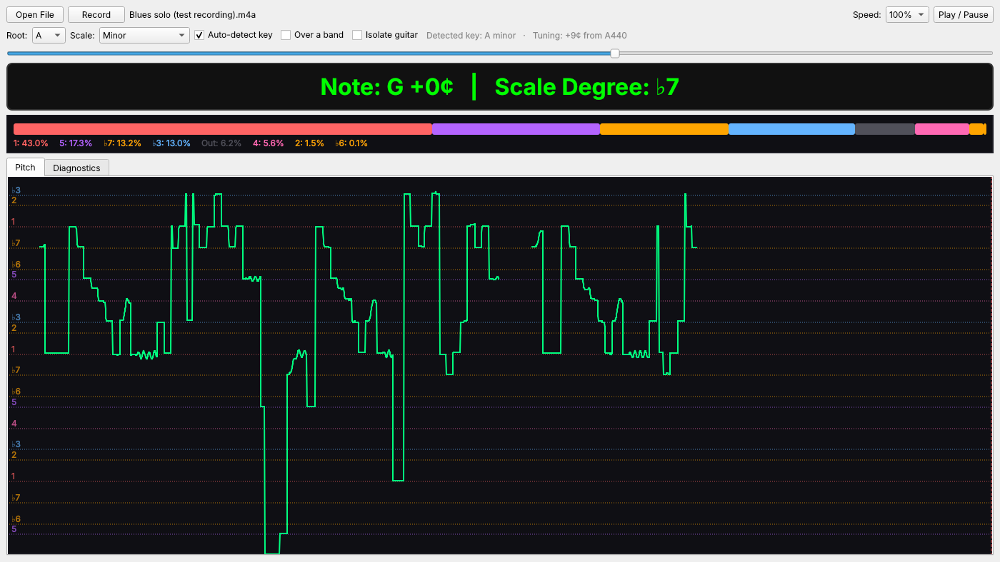
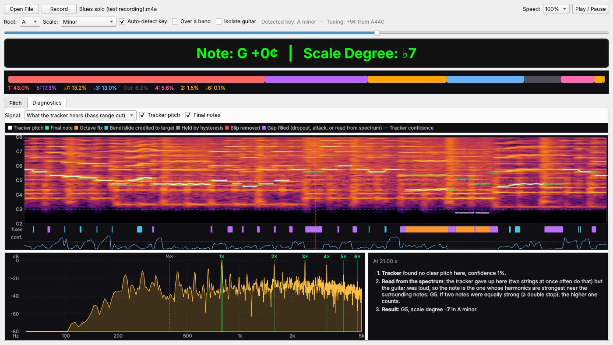

# Solo Analyzer

Open a video or audio file of a guitar solo, or record one straight into the app, and see what the notes are doing against a chosen key. The app tracks the pitch over time and shows:

- **Live readout** of the current note, how many cents sharp or flat it is (handy for checking bends), and its scale degree
- **Breakdown bar** showing how much of the solo sits on each scale degree, and how much is outside the scale
- **Scrolling pitch graph** of the last 30 seconds, drawn against the scale-degree lines. Click it to jump to that moment.
- **Diagnostics tab** that shows the audio the way the pitch tracker hears it, and explains why each note was chosen



## Download

Get the latest version from [Releases](../../releases/latest):

- **Windows:** `SoloAnalyzer-windows.exe`. Windows SmartScreen may warn because the app isn't signed. Click *More info → Run anyway*. Each launch takes a few seconds while the app unpacks itself.
- **macOS (Apple Silicon):** `SoloAnalyzer-macos.zip`. Unzip it, then right-click `SoloAnalyzer.app` → *Open* the first time, because the app isn't signed. macOS asks for microphone and camera access the first time you record.

The `GuitarSeparator-*.zip` files on the same page are the optional [guitar isolation pack](#isolate-guitar). You don't need to download them yourself: the app fetches the right one the first time you use **Isolate guitar**.

## Features

### Keys and scales

Major, minor, minor and major pentatonic, blues, Dorian and Mixolydian, in all 12 keys. The key is detected automatically when a file finishes analyzing. If another key fits almost as well (common with pentatonic playing), it's shown as "close" next to the detected key. Untick **Auto-detect key** to set the key yourself.

### Practice controls

- **Speed:** play at 25%, 50%, 75% or 100% without changing pitch.
- **Keyboard:** <kbd>Space</kbd> play/pause, <kbd>←</kbd>/<kbd>→</kbd> skip 5 s, <kbd>Shift</kbd>+<kbd>←</kbd>/<kbd>→</kbd> skip 1 s, <kbd>Home</kbd> back to the start.
- **Drag and drop** a video or audio file onto the window to open it.
- Analysis shows progress and can be cancelled. Results are cached, so reopening a file is instant.
- The app remembers your key, scale, speed, options, last folder and window size.

### Recording

Click **Record** to capture from your own hardware:

- **Audio only:** saves a 24-bit WAV to `Music/Solo Analyzer`.
- **Webcam + audio:** saves an MP4 to `Videos/Solo Analyzer` (`Movies` on macOS).

Pick any input: an audio interface, USB guitar cable, mic or webcam mic. A level meter shows your signal and warns if it clips. When you stop, the recording loads into the analyzer automatically.

**Raw input is on by default.** On Windows this bypasses the system's audio processing (automatic gain, noise suppression and "enhancements"), so the analyzer gets the tone as the device sends it. Raw mode only takes effect if the device's driver supports it, which most current interfaces and built-in mics do. macOS records input unprocessed anyway. Some USB webcams and headsets apply gain control inside the device itself, and no software can switch that off. For the cleanest signal, use an audio interface or guitar cable.

### Over a band

Tick **Over a band** when the solo has a loud bass under it. The tracker then ignores everything below middle C (C4), so a bass as loud as the guitar can't be mistaken for the lead. Leave it off for solo guitar, or if the lead goes below middle C.

### Isolate guitar

Tick **Isolate guitar** to separate the guitar from the drums, bass, keys and vocals with an AI model (Demucs) before the notes are tracked. The first time, the app offers to download the **guitar isolation pack**, about 250 MB, once. After that it works offline. Separation takes up to about the length of the song (measured at 0.5–2× real time on GitHub's Linux, Windows and Mac machines). The isolated audio is saved, so reopening the file or changing other options doesn't separate it again.

Measured with the real model on GitHub's machines:

| Notes found | Without | Isolated |
|---|---|---|
| Messy realistic recordings (all five, see [below](#accuracy)) | 83.6% | 94.2% |
| Clean recordings (no band) | 96.5% | 96.4% |
| Lead with a bass as loud as the guitar | 0% | 100% |
| Lead with a rhythm guitar as loud, same register | 18.5% | 40.0% |

It only partly separates two guitars from each other. Leave it off for solo guitar, where it adds time but no accuracy.

### Diagnostics tab



- **Spectrogram:** frequency (with note labels) over 8 seconds around the playhead. It overlays the tracker's raw pitch (white dots) and the final notes (green). Below it, a lane marks every correction: octave fixes, bends/slides credited to their target note, notes held by hysteresis, removed blips, and filled gaps. A second lane shows the tracker's confidence. Hover to read off a note and frequency, and click to jump there.
- **Spectrum at the playhead:** the frequency content of that instant, with the chosen note's harmonics marked (1×, 2×, 3×…). If the tracker's raw pick differed, it's marked too.
- **Step-by-step explanation** of the current moment, from what the tracker heard, through tuning, hysteresis, bend handling and corrections, to the final note and scale degree.
- **Signal switch:** compare what the tracker analyzes (bass range cut, or the isolated guitar) with the original audio.

## How it works

1. ffmpeg (bundled through `imageio-ffmpeg`) extracts mono audio at 22.05 kHz. With **Isolate guitar** on, Demucs first separates the guitar (its *guitar* and *other* stems) from the rest of the mix.
   Recordings capture audio through PortAudio (`sounddevice`) and webcam video through Qt, then ffmpeg combines them, correcting for the difference in start times.
2. Everything below 150 Hz is cut before tracking, so a bass guitar can't take over. Low guitar notes still track from their harmonics. **Over a band** raises this to ignore everything below C4. (Drum removal was tried and dropped: it smeared fast notes, and drums didn't disturb tracking in tests.)
3. librosa's pYIN tracks pitch between C2 and E6 (24th fret on the high E string), using 46 ms windows so fast runs stay sharp. It works in 10-second chunks so progress can be shown.
4. **Tuning:** the app measures how far the guitar is from A440 and judges notes relative to that. The offset is shown next to the detected key.
5. **Note tracking** turns the raw pitch into the notes being played:
   - **Vibrato** stays on its note. The note only changes once the pitch moves 0.7 semitones away.
   - **Bends and slides** count as the note they land on, so a D bent up to E never registers as D♯.
   - **Fast runs** aren't mistaken for slides: a slide glides (under 0.4 semitones per step), while a new note jumps.
   - **Octave errors** get corrected. Distorted guitars and double stops can fool the tracker into reporting a note one or two octaves (or an octave and a fifth) too low. A passage that sits far outside the surrounding register is folded back, but only if the spectrum supports the corrected note.
   - **Double stops** (two strings at once) make the tracker report a phantom pitch two octaves below the top note. The app recognizes a phantom because there's no real energy at that pitch, so the passage gets corrected even when it's held a long time.
   - **Note attacks:** right after a new note, the tracker needs about 0.1 s to commit. A short gap that stays loud is credited to the note that follows.
   - **When the tracker gives up** but the guitar is loud (common on double stops), the note is read straight off the spectrum.
   - Short blips are dropped only if they're also quiet or uncertain, so very fast tapped notes survive. Brief dropouts inside a held note are filled.
6. The readout, the breakdown bar and key detection all use these notes, so they always agree.
7. **Key detection** weighs how long each note is played against the Albrecht–Shanahan key profiles (measured on popular music), giving extra weight to notes that end a phrase, since solos tend to resolve on the tonic. Loudness tells a rest apart from a note's reverb tail.

## Accuracy

`benchmark/` contains test sets where the true note at every moment is known:

```bash
python benchmark/run.py          # synthetic solos: note accuracy, double stops, octave errors, breakdown bar, graph range
python benchmark/keys.py         # key detection over 12 roots x 7 scale types
python benchmark/realistic.py    # 5 messy "real-world" recordings, each with a clean control
python benchmark/separation_eval.py   # Isolate guitar on/off (needs torch + demucs; CI runs it)
```

`realistic.py` renders five deliberately messy recordings, each also rendered clean as a control:

1. Fast, high shred over a full band
2. A live phone bootleg
3. A practice room with the TV on
4. A fuzz lead with a rhythm guitar playing in the same register
5. Fast legato and tapping

The lead guitar has realistic string behaviour, intonation drift, pick and fret noise, and an amp, speaker and room. The interference includes cymbals, bass, rhythm guitar, crowd noise, TV speech, mains hum, hiss and a phone mic.

Current results, on renders and solos that weren't used for tuning:

| | Result |
|---|---|
| Realistic recordings, notes found: clean / messy | 96.5% / 83.5% (94.2% messy with **Isolate guitar**) |
| Fast (< 100 ms) and high (C6–E6) notes, messy | 93.1% |
| Synthetic solos, steady notes identified correctly | 98.5% |
| Keys detected correctly (252 solos, all keys and scale types) | 98.8% |

How the analysis improved, each round measured against the version before it:

| Round | What changed | Key result |
|---|---|---|
| 1 | Note tracking: tuning, vibrato, bends, octave errors | Steady notes 86.5% → 93.4%; graph range excess +2.0 → +0.4 octaves |
| 2 | Double stops, note attacks, key detection | Keys 86.5% → 96.8%; played moments with a note 94.3% → 99.2% |
| 3 | Fast and high notes over noise (realistic recordings) | Fast high notes, messy 60.3% → 93.1%; messy overall 61.3% → 83.5% |
| 4 | Isolate guitar (optional) | Messy overall 83.6% → 94.2% |

## Development

### Run from source

Requires Python 3.13.

```bash
pip install -r requirements.txt
python solo_analyzer.py
```

To use **Isolate guitar** from source, install PyTorch and Demucs into the same environment. The app then runs isolation directly, with no pack download:

```bash
pip install torch torchaudio      # on Linux, optionally add --index-url https://download.pytorch.org/whl/cpu for a smaller CPU-only build
pip install --no-deps demucs==4.0.1
pip install dora-search einops julius openunmix pyyaml tqdm omegaconf
```

(`--no-deps` skips dependencies Demucs only uses for saving audio files, which the app doesn't need. This is the same setup the CI tests run.)

### Tests

```bash
pip install pytest
python -m pytest tests
```

### Building and releasing

Two GitHub Actions workflows run automatically:

- `build.yml` runs the tests and builds the Windows and macOS apps with PyInstaller (`SoloAnalyzer.spec`) on every push to `main`. Builds can be downloaded from the run's page in the **Actions** tab.
- `separation.yml` runs the real-model **Isolate guitar** tests, then builds and smoke-tests the guitar isolation packs (`GuitarSeparator.spec`).

Pushing a version tag publishes a release with the apps and the isolation packs attached:

```bash
git tag v1.0.1
git push origin v1.0.1
```

## License

MIT. See [LICENSE](LICENSE).
